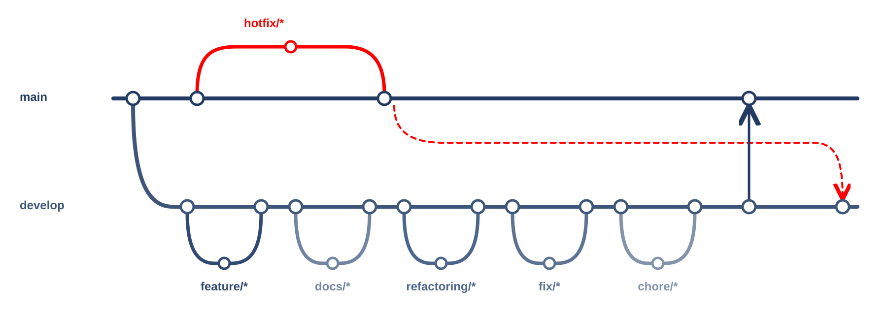

# 캠퍼스 자연어 경로 요청

서경대학교 캠퍼스 길찾기 앱의 자연어 경로 요청 처리입니다.

## 개발 목적

"짐이 많아서 계단 없이 북악관 편의점"처럼 말로 한 요청을 목적지·출발지·필수 조건·선호 같은 경로 조건으로 바꿉니다.
길은 만들지 않고 조건만 뽑으며, 지도에 없는 정보는 지원하지 않는다고 분명히 알립니다. 기기 안에서 동작하는 것을 목표로 합니다.

## 사용 도구

| 구분 | 도구 |
|---|---|
| 규칙 방식 | TypeScript(Hermes 호환), vitest |
| 소형 언어모델 | Gemma 3 270M 미세조정(transformers, PyTorch), llama.cpp(GGUF), llama.rn |
| 학습 환경 | Python, uv, Google Colab(GPU), Hugging Face(비공개 저장소) |
| 평가 | 합성 시험 문장, 지표 스크립트 |

## 브랜치와 PR

- `main`: 배포용. 일반 변경은 PR로 병합.
- `develop`: 개발 통합용.
- `feature/*`, `docs/*`, `refactoring/*`, `fix/*`, `chore/*`: `develop`에서 분기 → 작업·검증 → PR → `develop` 병합.
- 배포 준비 완료 후 `develop` → `main` PR.
- `hotfix/*`: `main`에서 분기 → 검증 → PR 없이 `main` 병합·push. 같은 수정을 `develop`에도 반영.

PR은 목적·변경·확인·배포/후속을 각각 한 줄로 적습니다. 미검증은 이유를 적고, 배포 영향이나 후속 작업이 없으면 `없음`을 적습니다.

실행 방법과 개발 세부 내용은 [개발 가이드](docs/개발-가이드.md)에 있습니다.
